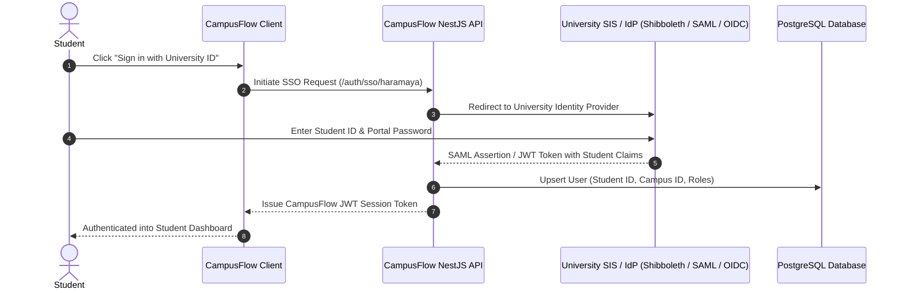

# University Systems & Institutional IT Integration Architecture

## Strategic Vision

CampusFlow is designed as an interoperable digital services layer for Ethiopian higher education. While the pilot begins as a standalone, zero-friction web and mobile application, deep institutional integration ensures long-term defensibility, administrative endorsement, and campus-wide ubiquity.

This document outlines the architectural roadmap for integrating with University Student Information Systems (SIS), campus network infrastructure, and payment gateways.

---

## 1. Identity & Single Sign-On (SSO) Integration



### Staged Identity Roadmap

| Phase | Authentication Method | Technical Specification | Institutional Effort |
| :--- | :--- | :--- | :--- |
| **Phase 1 (Pilot)** | **Campus Email Domain Verification** | Verify institutional email domains (`@haramaya.edu.et`) with email confirmation links and optional Ethio Telecom SMS OTP. | **Zero** (Requires no IT approvals) |
| **Phase 2 (Adoption)** | **LDAP / Active Directory Sync** | Query university directory services over secure LDAP (LDAPS) using a dedicated service account. | **Low** (Read-only student directory query) |
| **Phase 3 (Enterprise)** | **Federated OIDC / SAML 2.0** | Standards-compliant OpenID Connect or Shibboleth/SAML SSO federation with automatic student status verification. | **Medium** (Standard university IdP configuration) |

---

## 2. Campus Wi-Fi Captive Portal & Zero-Rating

### The Problem
During peak hours, university bandwidth limits or captive network logins can interrupt student internet access, preventing order placement.

### The Solution: Zero-Rating Whitelist Partnership
Work with the university's ICT Directorate to add CampusFlow domain endpoints to the campus Wi-Fi "walled garden" (unrestricted access without entering captive credentials):

```nginx
# Campus Gateway Whitelist Rule (ICT Directorate configuration example)
ipset add walled_garden app.campusflow.et
ipset add walled_garden api.campusflow.et
ipset add walled_garden cdn.campusflow.et
```

* **Outcome:** Students can order cafeteria food, book bus tickets, and download lecture notes even if their external internet quota has expired.

---

## 3. Academic Registrar & SIS Synchronization

Integrating with the University Registrar's system enables:

1. **Course & Department Sync:** Automatically populating colleges, departments, and course codes (`AGEC-1011`, `COSC-2022`) into the Academic Resource Bank (`/learning`).
2. **Official Academic Calendar:** Ingesting semester dates, final examination periods, and holidays directly into the Transport and Housing availability schedules.
3. **Automated Degree & Enrollment Validation:** Verifying graduating students for thesis printing & binding services at campus stationery shops.

---

## 4. National Payment Gateway Integrations

```text
Student Checkout (App)
       │
       ├── Telebirr USSD Engine (*127*1*251911223344*Amount#)
       ├── Telebirr In-App Mini-App / Web Payment Gateway
       └── Commercial Bank of Ethiopia (CBE Birr & CBE Mobile API)
```

1. **Telebirr Direct Merchant API:** Transition from USSD prompt generation to direct QR-based in-app payments via Ethio Telecom's Telebirr B2B Open Platform.
2. **CBE Birr Open Banking:** Automated push notification prompts sent directly to the customer's CBE Birr mobile wallet for 1-click debit.

---

## 5. Regulatory & Governance Framework

All integrations are built in strict compliance with:
* **Federal Proclamation No. 1321/2024:** Ethiopian Personal Data Protection Proclamation (data minimization, encrypted transit, local data retention).
* **Higher Education Proclamation No. 1152/2019:** Ensuring campus commercial activities support student welfare without disrupting academic operations.
